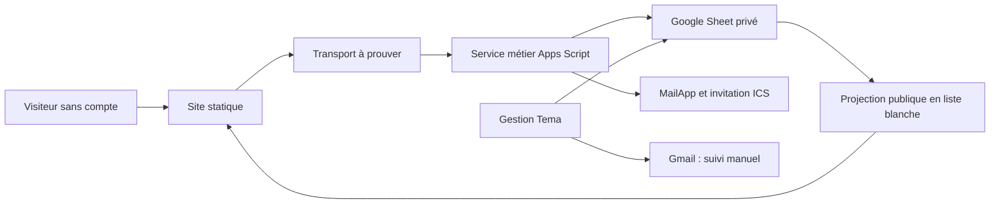
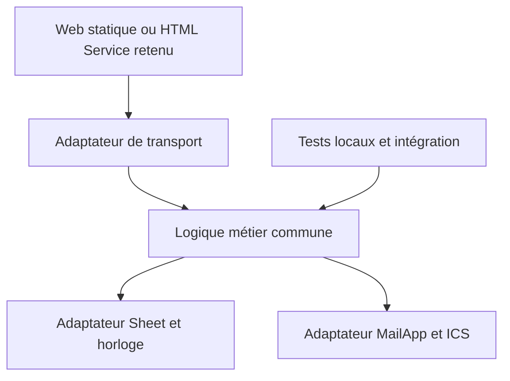
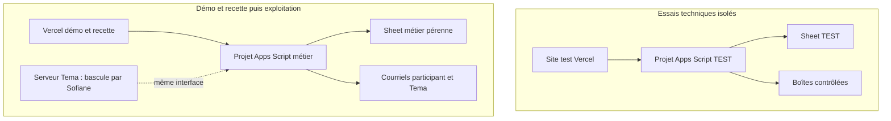

# Architecture — Tema Académie V1

Architecture d’ensemble approuvée par Sofiane le 26 octobre 2026 après présentation dans le chat. Spécification fonctionnelle et parcours/dispositions UX approuvés ; finition graphique différée. Les principes marqués **[ADOPTED]** viennent des arbitrages humains ou du dépôt constaté. Les mécanismes précisés dans leurs règles sont la proposition technique déléguée, encore non éprouvée. Aucun statut documentaire ne vaut essai exécuté ou GO de développement/livraison.

## Design Paradigm

Architecture en couches avec adaptateurs gérés : site statique portable, un service métier Apps Script et un Sheet privé comme source de données. Google Sheets est l’administration de Tema ; Gmail sert au suivi manuel. Le navigateur soumet une demande ; le moteur Google contrôle, enregistre puis tente les notifications.



## Invariants & Rules

### AD-1 — Dépôt et frontières de publication [ADOPTED]

- **Binds:** CAP-1 à CAP-8 ; sources, tests et publication.
- **Prevents:** Séparation de l’historique produit et de son contrat ; publication des données privées ou du socle.
- **Rule:** Un dépôt `tema-academie`, socle à la racine ; futur code sous `app/web`, `app/apps-script`, tests sous `app/tests`. Publication web limitée au build statique ; publication Google limitée à une liste maîtrisée de fichiers serveur et manifeste. Aucun test, secret ou donnée d’inscrit dans ces sorties. Mises à jour du socle examinées, sans synchronisation automatique. Aucun commit sans demande explicite.

### AD-2 — Un moteur Google, un site portable [ADOPTED]

- **Binds:** CAP-1 à CAP-7 ; présentation, transport, données et courriels.
- **Prevents:** Deux moteurs de réservation ; capacité décidée par le navigateur ; dépendance au serveur Vercel.
- **Rule:** Apps Script est seul propriétaire des mutations d’inscription applicatives. Les adaptateurs décodent le même contrat et appellent le même service ; aucune règle métier recopiée dans le transport. La logique pure testable est séparée de Sheet/MailApp/horloge. Code serveur compatible Apps Script V8, sans API Node/DOM ou modules ES non transformés ; Node est seulement un outil local/CI. Aucun serveur applicatif à exploiter, fonction Vercel ou base externe. Le site lit une projection publique, jamais le classeur brut ; le compteur affiché ne garantit pas une place.



### AD-3 — Identités, contrat et temps

- **Binds:** CAP-1 à CAP-7 ; onglets, API, formulaires et agenda.
- **Prevents:** Liaison par titre/position ; codes instables ; interprétations divergentes des conditions et horaires.
- **Rule:** Le [contrat de données](../../../specs/spec-tema-academie-v1/contrat-donnees.md) fixe les en-têtes/types et schémas logiques V1 pour tous les adaptateurs. Quatre onglets : Formations, Disponibilités, Inscriptions, Paramètres. Code formation automatique, lisible, unique, protégé puis immuable : préfixe logiciel `DIV`/`DIMO`/`MOOV`, trois premiers caractères A-Z/0-9 du titre après NFKD, suppression des diacritiques et majuscules (titre sans caractère utilisable : diagnostic), compteur global croissant sur au moins trois chiffres (ex. `DIV-ERG-001`). Pour un logiciel ajouté ultérieurement, prendre les quatre premiers caractères alphanumériques de son identifiant stable dans Paramètres ; libellé renommé sans changer cet identifiant ni les codes existants. Le générateur commun réserve sous verrou un compteur serveur supérieur au maximum déjà attribué avant écriture ; trous permis, réutilisation interdite. ID cohorte `C-UUID`, inscription `I-UUID`, demande UUID ; aucun ID existant régénéré. Paramètres porte identifiant logiciel stable et libellé renommable ; nouvel ID normalisé alphanumérique, collision résolue par suffixe sous verrou. Listes natives Sheets contenant `ID — Libellé` pour logiciel et formation : ID avant le premier séparateur exact, vérifié unique, suffixe d’affichage rafraîchissable. Aucune valeur cachée native présumée. Projection `formations[].logiciel = softwares[].id` ; choix formation résolu vers son code stable. Import des noms source seulement si résolution unique. Les shapes privés de `formation_snapshot`/`lieu_snapshot` et instants UTC sont communs au producteur Inscription et à Mail/ICS, fixés dans le contrat. Dates locales Toronto, instants UTC, aucun décalage fixe ; heure locale ambiguë/inexistante refusée. Révision opaque des conditions et empreinte métier canoniques produites par le service selon le contrat ; instantanés conservés. ICS : UID stable par inscription, UTC avec `Z`, sans `TZID` concurrent.

### AD-4 — Une place, concurrence et reprise [ADOPTED]

- **Binds:** CAP-4/6/7 ; écritures d’inscription et calcul des confirmés.
- **Prevents:** Surréservation par deux requêtes ; seconde inscription au rejeu ; réactivation d’une annulation.
- **Rule:** Un seul projet Apps Script fait autorité pour un Sheet (AD-9). Acquérir `getScriptLock()` effectivement avec attente bornée. Non acquis : `BUSY`, sans mutation ni conclusion sur une demande non relue. Sous verrou, rechercher d’abord `request_id` : même empreinte retourne le statut courant, même après annulation/fermeture/changement de politique ; autre contenu donne `RETRY_CONFLICT` sans modifier ni divulguer le reçu. Nouvelle demande : contrôler données/consentement/politique, révision, activité, validité, ouverture, début, doublon courriel normalisé/cohorte et capacité à partir des confirmés. Admission = derniers contrôles frais réussis immédiatement avant écriture. Une fermeture manuelle postérieure laisse finir cette demande avec ses conditions acceptées ; les demandes contrôlées ensuite sont refusées. Le simple formulaire ouvert ne réserve rien ; début horaire contrôlé au point d’admission, sans tolérance supplémentaire implicite. Écrire au plus une ligne avec instantanés, `flush()` avant libération en `finally`, confirmer seulement après écriture établie ; résultat incertain = reprise de la même demande. Annulation conserve sa ligne ; réinscription = nouvelle demande/nouvelle ligne sous conditions courantes. Le verrou coordonne les scripts, jamais les éditions humaines.

### AD-5 — La place reste acquise si le courriel échoue [ADOPTED]

- **Binds:** CAP-4/5/7 ; confirmation participant et avis Tema.
- **Prevents:** Perte d’une place pour un problème email ; double envoi au rejeu ; garantie de réception inventée.
- **Rule:** Après enregistrement, une tentative initiale participant puis une tentative d’avis Tema, avec états indépendants du statut d’inscription. Claim `PENDING → SENDING` sous verrou, ID/date de tentative, envoi hors verrou, résultat certain `SENT/FAILED` ; interruption = état incertain `UNKNOWN` ou `SENDING` non abouti. Avant engagement participant, relire inscription et révision : annulée → `SUPPRESSED`, conditions différentes → `BLOCKED`, suivi manuel. Un envoi déjà engagé ne peut être retiré atomiquement par une édition humaine. L’avis Tema signale l’échec détecté ou le suivi nécessaire si le traitement/service le permet ; s’il échoue aussi, trace privée, sans troisième alerte. Aucun renvoi par rejeu, menu, délai de dix minutes, tâche de relance ou autre canal. `SENT` signifie acceptation MailApp ; réception et import agenda exigent une observation réelle. Tema poursuit manuellement dans Gmail ; lien visio manquant communiqué plus tard manuellement, sans mise à jour agenda automatique.

### AD-6 — Transport décidé sur preuve

- **Binds:** CAP-2/4/5/7 ; navigateur et interface Google.
- **Prevents:** Faux succès interorigines ; changement de navigation imposé ; schémas d’erreur propres à chaque transport.
- **Rule:** Principe d’interface Apps Script retenu, détails délégués. Candidat A : POST simple depuis le site et résultat métier lisible ; alternatives B HTML Service/RPC ou C navigation POST native seulement si nécessaires. Un seul transport sera retenu après ET-01 à ET-05/ET-11 du [plan](../../../specs/spec-tema-academie-v1/plan-essai-technique.md) ; rejouer les scénarios critiques sur le repli. Même contrat `recording_status: recorded/not_recorded/unknown`, statut courant `confirmee/annulee/null`, codes et reçu minimal. Une réponse perdue reste inconnue ; pas de nouvelle clé avant résolution de la demande incertaine. `no-cors` opaque, JSONP ou succès HTTP seuls ne prouvent aucune réservation. `google.script.run` seulement dans HTML Service. Repli modifiant parcours/coût/périmètre présenté à Sofiane avant adoption. La preuve navigateur est bloquante pour le développement principal du parcours.

### AD-7 — Projection publique et données privées

- **Binds:** CAP-1/4/5/7 ; site, formulaire, Sheet, emails et ICS.
- **Prevents:** Fuite d’inscrits/liens privés ; formule/script exécutable ; secret simulé dans le navigateur.
- **Rule:** Projection en liste blanche du contrat : adresse présentielle et contact public autorisés ; aucun inscrit, code formateur, destinataire interne ou lien visio. Champs/accord/version vérifiés serveur avec instant serveur ; aucun accord marketing implicite. Textes inertes dans toutes les sorties, dont cellules, en-têtes email et ICS. URL publique et contrôle d’origine ne sont ni secret ni authentification ; permissions Google pour édition, aucune clé dans Vite. Coordonnées transitoires en mémoire de page, pas d’URL ni stockage durable client. Tests sur données fictives ; traces minimales privées sans corps/email complet ni donnée personnelle dans rapports livrés. Conservation 12 mois et nettoyage manuel Emma selon politique à faire valider par Tema, sans purge automatique ou rôle juridique déduit. DUPLICATE ne divulgue ni reçu ni coordonnée ; ce code et le message UX indiquent toutefois l’existence d’un doublon pour la paire courriel/session. Honeypot/délai limitent les abus sans garantir l’absence d’énumération ; limiter la fréquence des requêtes doit être éprouvé avant ouverture, sans fournisseur ajouté implicitement. Aucun objectif de masquage complet de cette existence n’est déclaré atteint.

### AD-8 — Administration simple et actualisation [ADOPTED]

- **Binds:** CAP-1/2/3/4/6 ; catalogue, Sheet et projection.
- **Prevents:** Seconde commande de publication ; automatisme dépendant d’un onEdit manqué ; état public différent selon les vues.
- **Rule:** Conserver les neuf informations métier client, dont la capacité source comme valeur indicative par formation pour préremplir une nouvelle session, sans plafond ni modification des sessions existantes. Données tabulaires exportables vers Excel ; calculs script, sans dépendance QUERY/ARRAYFORMULA/IMPORTRANGE. Logiciel en liste administrable Paramètres ; Formateurs texte libre interne. Nouvelle formation inactive ; nouvelle date avec Inscriptions ouvertes décoché. Aucun booléen `publie` supplémentaire : visibilité calculée depuis activité/validité/futur/ouverture et confirmés. Fermée future avec confirmé : `closed` / Inscriptions terminées, prioritaire sur Complet ; fermée sans confirmé masquée, ouverte sans place `full`, ouverte avec place `open`. Formation active sans date visible : Dates à venir ; inactive et dates masquées, historique conservé. Annulées exclues des comptes. Modification sensible : fermer, modifier la même ligne, prévenir manuellement, rouvrir selon date/capacité ; pas de menu supplémentaire. Capacité inférieure aux confirmés : nouvelles inscriptions bloquées et diagnostic, aucune annulation automatique. Validation/IDs par même service sur édition et import ; réparation périodique candidate chaque minute pour événements manqués, sans envoi ou relance email. En-têtes uniques lus par nom, lignes invalides isolées, identités ambiguës non publiées. Lecture publique non mutante depuis données courantes, sans cache serveur initial ; catalogue/calendriers visibles relus au plus toutes les trente secondes et au retour au premier plan. Aucun watcher du formulaire : contrôle à la soumission. Cible approuvée <2 minutes, à mesurer avec durée/quota des déclencheurs, charge et événements manqués en ET-09 ; cadence non garantie par la seule documentation Google.

### AD-9 — Environnements et versions [ADOPTED]

- **Binds:** CAP-3 à CAP-8 ; ressources, tests et maintenance.
- **Prevents:** Tests sur le classeur métier ; deux verrous de projets distincts pour les mêmes places ; récupération effaçant les inscriptions.
- **Rule:** TEST : Sheet/projet/déploiement distincts, données fictives et destinataires contrôlés. MÉTIER : compte, Sheet et moteur pérennes, conservés lors du transfert du site. Un projet écrivain par Sheet, destination/environnement fixés serveur, jamais par le visiteur ; plusieurs URLs du même projet partagent ce moteur/verrou. Quotas éventuellement partagés par compte, à mesurer. Vercel accueille démo/recette ; Sofiane garde la bascule du front vers serveur Tema avant ouverture publique, détails FTP non bloquants pour la démo. Sources/outils versionnés, candidat et couples site/script identifiés ; web app versionnée, pas HEAD public. Triggers sur code sauvegardé HEAD : aucun développement expérimental dans le projet métier ; code sauvegardé et version déployée doivent rester compatibles avec le même schéma/candidat. Maintenance minimale : conserver les versions et une courte note pour rétablir un couple compatible sans restaurer le Sheet. Aucun nouvel outil ou procédure détaillée à gérer côté Tema. Déploiement/reprise réels gardent leur autorisation propre.

### AD-10 — Preuves, coûts et engagements

- **Binds:** CAP-1 à CAP-8 ; dossier, essai, développement et remise.
- **Prevents:** Réalisation fondée sur une liaison non prouvée ; accès ou dépenses présumés acquis ; confusion recette/livraison.
- **Rule:** Avant essai : accès/récupération Google, espace et forfait Vercel compatible, URLs/ressources test, quota et trois boîtes contrôlées constatés. Création Sheet/projet par Computer Use demandée, conditionnée à l’accès et structure convenue ; aucune ressource déjà créée. Plan complet et GO limité restent distincts de son ordre approuvé. Confirmer transport, limites et estimation avec non-régression avant développement principal. MailApp grand public : plafond documentaire 100 destinataires/jour au 26 octobre, pas 100 inscriptions ; quota restant et coût runtime à vérifier. Hobby Vercel personnel non commercial : offre réelle à constater, aucun achat ici. Avant ouverture publique : politique/accord, conservation, sessions/prix/marque Tema et finition graphique validés. Livraison = destination acceptée, import, recette, guide et tests transmissibles, ronde d’ajustements/remise 30 minutes ; Vercel peut être une étape acceptée, sans valoir ouverture publique. Aucun GO de code, essai, commit, achat ou livraison déduit du dossier final.

### AD-11 — Non-régression reproductible [ADOPTED]

- **Binds:** CAP-1 à CAP-8 ; tout changement applicatif et remise.
- **Prevents:** Recette ponctuelle non rejouable ; simulation assimilée à Google réel ; publication d’une régression connue.
- **Rule:** Appliquer [strategie-tests.md](../../../specs/spec-tema-academie-v1/strategie-tests.md) : logique pure commune exercée localement par Node test runner, contrats/API, quelques parcours Playwright versionnés et Computer Use de recette réelle. Même commande déterministe locale avant push applicatif puis CI sur push/PR avant intégration/livraison ; un échec bloque, un contrôle requis indisponible reste NON VÉRIFIÉ. La CI post-push complète le contrôle local préalable. Horloge/fixtures/version contrôlées ; mail simulé pour répétition, essais Google réels bornés sur TEST. Couvrir dernière place concurrente, replay/annulation, fermeture avant/après admission, révision, visibilité, confidentialité, envoi en échec et états inconnus. API serveur ≠ preuve navigateur ; WebKit ≠ Safari réel ; MailApp accepté ≠ réception. Aucun test/pipeline installé ou exécuté par ce document.

## Consistency Conventions

| Sujet | Convention commune |
|---|---|
| Contrats | Schémas logiques V1 et règles de normalisation dans contrat-donnees.md ; même implémentation canonique côté service |
| Codes | RECORDED, REPLAY, FULL, CLOSED, NOT_FOUND, DUPLICATE, INVALID, CONSENT_REQUIRED, POLICY_CHANGED, SESSION_CHANGED, RETRY_CONFLICT, BUSY, UNAVAILABLE |
| Statuts | Réservation confirmee/annulee, résultat recorded/not_recorded/unknown ; envois PENDING/SENDING/SENT/FAILED/UNKNOWN/BLOCKED/SUPPRESSED séparés |
| Identités | Pas de clé par titre/numéro de ligne ; code + titre dans la sélection, code stable stocké |
| Temps | Toronto pour saisie/affichage ; UTC pour API, traces et ICS ; horloge injectable pour tests |
| UX | EXPERIENCE.md gouverne tri, filtres, mois, sélection, retours et messages ; dispositions approuvées, finition graphique différée |
| Versions | Révision du candidat/empreinte si aucun commit autorisé, build site, version/déploiement Google, schéma et environnement identifiés |

## Stack

Seed vérifié le 26 octobre 2026, non installé. Versions exactes proposées pour le futur verrouillage ; imposer Vite 8.3.5 au starter (dont le manifeste propose ^8.3.4), conserver le lockfile, revérifier au GO sans mise à jour automatique. Services gérés sans version runtime épinglable par nous.

| Name | Version |
|---|---|
| Node.js, outillage et test runner natif | 24.22.1 LTS Krypton |
| Vite, build web vanilla JavaScript | 8.3.5 |
| create-vite, starter officiel vanilla | 9.3.1 |
| Google clasp, synchronisation locale Google | 3.4.1 |
| Playwright Test | 1.64.1 |
| Google Apps Script | V8 géré ; manifeste et fuseau versionnés |
| Google Sheets / SpreadsheetApp | Service géré ; contrat applicatif V1 |
| MailApp | Service géré ; quotas à constater |
| Vercel / GitHub Actions | Services gérés ; configuration du candidat versionnée |

Preuves : [Node index](https://nodejs.org/dist/index.json), registres officiels [Vite](https://registry.npmjs.org/vite/8.3.5), [create-vite](https://registry.npmjs.org/create-vite/9.3.1), [clasp](https://registry.npmjs.org/@google%2fclasp/3.4.1), [Playwright](https://registry.npmjs.org/@playwright%2ftest/1.64.1), [starter vanilla](https://vite.dev/guide/), [V8](https://developers.google.com/apps-script/guides/v8-runtime), [CI Playwright](https://playwright.dev/docs/ci-intro), [triggers](https://developers.google.com/apps-script/guides/triggers), [déclencheurs périodiques](https://developers.google.com/apps-script/guides/triggers/installable), [HEAD pour triggers](https://developers.google.com/apps-script/api/reference/rest/v1/projects/updateContent), [versions publiques](https://developers.google.com/apps-script/concepts/deployments), [quotas](https://developers.google.com/apps-script/guides/services/quotas), [verrou](https://developers.google.com/apps-script/reference/lock/lock-service), [MailApp](https://developers.google.com/apps-script/reference/mail/mail-app). Lectures documentaires, pas preuves d’exécution.

## Structural Seed

```text
app/
  web/          # sources/assets publics ; build statique dist
  apps-script/  # logique pure, adaptateurs Google, appsscript.json
  tests/        # fixtures fictives, tests locaux, contrats, E2E
```

Aucun `app/` créé. Pas de framework UI nécessaire au seed ; starter Vite vanilla recommandé. Le build web ne contient que la configuration publique et se transporte hors Vercel. Création des ressources Google via Computer Use ; synchronisation ultérieure des sources versionnées par clasp, sans y stocker les jetons.



## Capability → Architecture Map

| Capability / Area | Lives in | Governed by |
|---|---|---|
| CAP-1 Catalogue | Web, projection, Formations | AD-1/2/3/7/8/11 |
| CAP-2 Calendriers | Web, projection, Disponibilités | AD-2/3/6/8/11 |
| CAP-3 Administration | Sheet, validateur/générateur commun, guide | AD-3/7/8/9/11 |
| CAP-4 Inscription | Transport retenu, moteur, Inscriptions | AD-2/3/4/6/7/11 |
| CAP-5 Courriels/agenda | États privés, MailApp, ICS | AD-3/5/7/9/10/11 |
| CAP-6 Changements | Statut Sheet, calculs et Gmail manuel | AD-3/4/5/8/11 |
| CAP-7 Confidentialité/résilience | Projection, contrôles, erreurs et accès | AD-4/5/6/7/9/10/11 |
| CAP-8 Remise | Guide, comptes, versions et tests transmissibles | AD-1/9/10/11 |

## Deferred

- **Transport effectif :** A reste candidat ; preuve ET-01 à ET-05/ET-11 et décision d’effet UX/coût bloquent le parcours principal. Tous les transports doivent respecter AD-3/4/6, aucun adaptateur libre d’inventer son protocole métier.
- **Cadence/quotas Google :** réparation minute et relecture publique trente secondes à éprouver en ET-09 ; ne pas installer sans mesurer runtime/charge du compte et cible <2 minutes. Toute impossibilité modifiant cette cible revient à Sofiane.
- **Accès, forfait et lancement d’essai :** constat Google/Vercel, trois adresses, budget borné et plan complet avant GO limité ; aucune dépense ni connexion présumée.
- **Valeurs avant publication :** politique/accord/conservation, sessions/prix/marque et finition graphique à faire valider. Données manquantes ne sont jamais inventées ; contrats et états restent fixés ici.
- **Détails de build et fichiers :** commandes, assemblage serveur V8, sélecteurs E2E, styles et organisation interne au développement autorisé. Les règles, schémas et dépendances ci-dessus sont partagés ; tout nouveau runtime/fournisseur ou changement de parcours/coût revient au cadrage.
- **Serveur Tema :** domaine, HTTPS, chemins et livraison/transfert sous responsabilité Sofiane avant ouverture publique ; n’empêchent pas Vercel. Intégration David, paiements, comptes, groupes et webinaires hors V1.
