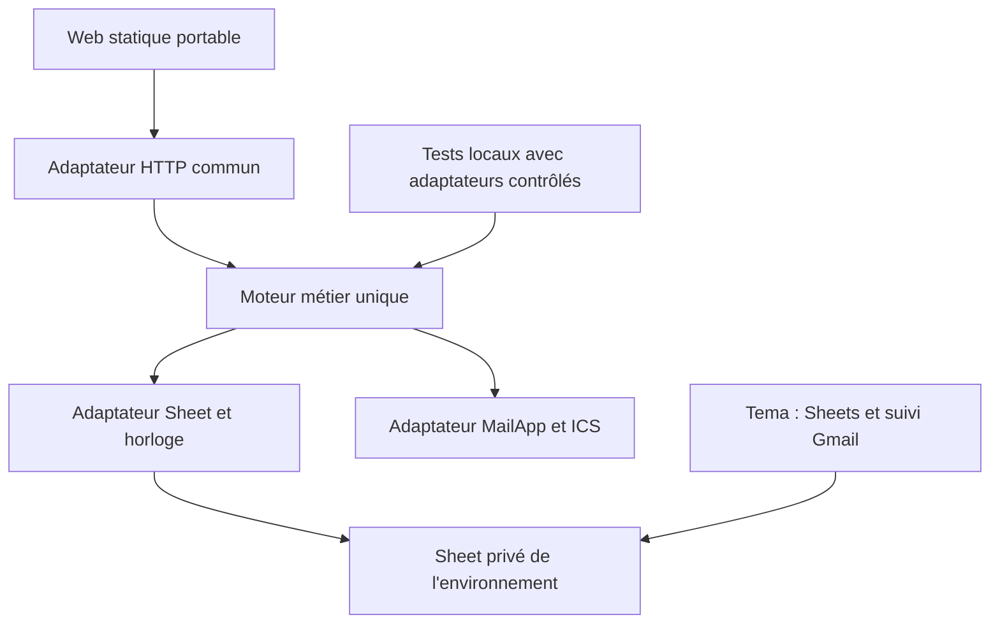
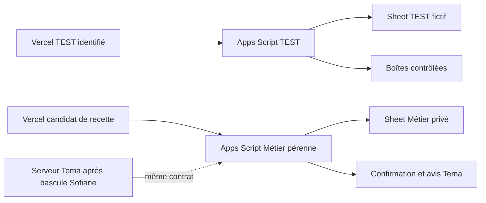

# Architecture — Tema Académie V1

Architecture d’ensemble approuvée par Sofiane le 26 octobre 2026 ; consolidation documentaire demandée le 28 octobre avant revue UX/UI. Les11AD conservent leurs identifiants. `[ADOPTED]` désigne un principe déjà validé ou constaté, sans certifier l’implémentation de chaque règle. Le prototype TEM-6 existe : bilan 4 ET PASS / 8 NON VÉRIFIÉ, suite locale 61 Node / 28 Playwright. L’extension tarifaire, la cadence 5 min et le limiteur décrits ici restent à réaliser et vérifier. Aucun GO principal ou déploiement n’est déduit de ce contrat.

## Design Paradigm

Architecture en couches et adaptateurs gérés : web statique portable, service métier Apps Script unique, Sheet privé comme source métier ; Gmail pour le suivi humain. Node et les tests s’exécutent en local/CI, le moteur de mutation en V8 Google. Le navigateur ne réserve aucune place avant le résultat établi du moteur.



## Invariants & Rules

### AD-1 — Dépôt et frontières de publication [ADOPTED]

- **Binds:** CAP-1 à CAP-8 ; sources, tests et publication.
- **Prevents:** Contrats séparés de l’historique produit ; publication des données privées ou du socle.
- **Rule:** Un dépôt `tema-academie`, socle à la racine, application dans `app/web`, `app/apps-script`, `app/tests`. Seul le build web statique est public ; publication Google limitée aux sources serveur/manifeste nécessaires. Tests, secrets, participants et documents du socle absents des sorties. Commits par jalon autorisés par Sofiane ; branche de travail et PR brouillon n’autorisent ni fusion, ouverture publique ou livraison. Préserver les travaux indépendants et vérifier le candidat aux checkpoints.

### AD-2 — Un moteur Google et un site portable [ADOPTED]

- **Binds:** CAP-1 à CAP-7 ; présentation, transport, données et courriels.
- **Prevents:** Deux moteurs de réservation ; décision de capacité par le navigateur ; dépendance au serveur Vercel.
- **Rule:** Apps Script possède les mutations applicatives d’inscription. Tous les adaptateurs décodent le même contrat et appellent le même service, sans réimplémenter les règles. Logique pure séparée de Sheet/MailApp/horloge ; code serveur compatible V8 Google sans API Node/DOM. Node sert uniquement à l’outillage/tests/build. Aucun serveur applicatif Vercel ou base externe. Le site lit la projection, jamais le classeur brut. Ses vues doivent fonctionner avec des fichiers statiques sans réécriture serveur obligatoire : accès direct et actualisation des URLs sont vérifiés sur le build portable ; seules des références publiques, jamais des coordonnées, vont dans l’URL.

### AD-3 — Identités, contrat et temps

- **Binds:** CAP-1 à CAP-7 ; onglets, API, formulaires et agenda.
- **Prevents:** Liaison par titre ou position ; codes instables ; interprétations divergentes du prix, des conditions et des horaires.
- **Rule:** [contrat-donnees.md](../../../specs/spec-tema-academie-v1/contrat-donnees.md) est la référence commune des en-têtes/types, schémas V1, canonisation/révision et instantanés privés. Quatre onglets : Formations, Disponibilités, Inscriptions, Paramètres. Code formation lisible automatique et immuable : préfixe logiciel `DIV`/`DIMO`/`MOOV`, trois premiers alphanumériques du titre normalisé NFKD sans diacritiques, compteur global croissant réservé sous verrou avant écriture sur au moins 3 chiffres ; trous permis, réutilisation interdite. Nouveau logiciel : préfixe depuis les quatre premiers alphanumériques de son ID stable, jamais du libellé renommable. Logiciels : ID stable unique et libellé renommable ; nouvel ID normalisé, collision suffixée sous verrou. Listes Sheets `ID — Libellé`/`code — titre`, ID avant premier séparateur exact vérifié unique ; aucune valeur cachée native présumée. ID cohorte `C-UUID`, inscription `I-UUID`, demande UUID. `formations[].logiciel=softwares[].id`, `sessions[].formation=formations[].id`. Aucun ID existant régénéré. Temps local `America/Toronto`, UTCZ pour API/traces/ICS ; heure locale ambiguë/inexistante refusée. Instantanés figés à l’admission et partagés Mail/ICS ; UID ICS stable par inscription, UTCZ sans `TZID` concurrent. Prix absent→`null`, jamais zéro. La projection conserve `status:open|full|closed` et ajoute `registration_enabled:boolean`, `registration_block_reason:null|price_unconfirmed` : éligibilité vraie seulement si `status === 'open'` et prix numérique valide renseigné ; raison `price_unconfirmed` seulement si `status === 'open'`/prix absent, sinon null. Zéro numérique explicite est distinct de l’absence ; aucun champ d’approbation du prix ajouté.

### AD-4 — Une place, concurrence et reprise [ADOPTED]

- **Binds:** CAP-4/6/7 ; admission, écritures et calcul des confirmés.
- **Prevents:** Surréservation ; seconde inscription au rejeu ; annulation réactivée ou inscription à tarif absent.
- **Rule:** Un projet écrivain par Sheet. Acquérir effectivement le verrou script avec attente bornée ; sinon `BUSY/unknown`, sans mutation ni conclusion sur une demande non relue. Sous verrou, rechercher d’abord request_id : même empreinte→reçu/statut courant même après fermeture, politique modifiée ou annulation, sans place/email supplémentaire ; autre contenu→`RETRY_CONFLICT`, sans divulgation. Pour une nouvelle demande : limiteurAD-7, champs/accord/politique, révision, activité/validité, prix renseigné, ouverture, début, doublon courriel normalisé/cohorte, capacité courante depuis confirmées. Prix absent→`CLOSED/not_recorded`, `message_key:price_unconfirmed`, erreur `{field:prix,code:PRICE_UNCONFIRMED}`. Admission=derniers contrôles frais réussis juste avant écriture. Fermeture manuelle postérieure laisse finir cette demande avec ses instantanés ; suivantes refusées. Début horaire contrôlé à l’admission sans tolérance supplémentaire. Écrire au plus une ligne, `flush()` avant libération en `finally` ; confirmer seulement après écriture établie, sinon reprise de la même demande. Annulation garde ligne/ID ; réinscription exige nouvelle demande sous conditions actuelles. Le verrou coordonne les scripts, jamais les éditions humaines.

### AD-5 — La place reste acquise si le courriel échoue [ADOPTED]

- **Binds:** CAP-4/5/7 ; confirmation participant et avis Tema.
- **Prevents:** Perte de place pour un incident email ; double envoi au rejeu ; réception inventée.
- **Rule:** Après réservation, une tentative initiale participant puis une tentative d’avis Tema, états indépendants de la réservation. Claim `PENDING→SENDING` sous verrou, ID/date de tentative, envoi hors verrou, résultat certain `SENT/FAILED` ; interruption→`UNKNOWN` ou `SENDING` non abouti. Avant engagement participant, relire inscription/révision : annulée→`SUPPRESSED`, conditions modifiées→`BLOCKED`, suivi manuel. Un envoi déjà engagé ne peut être retiré atomiquement par une édition humaine. Avis Tema signale l’échec détecté ou lien manquant si le traitement/service le permet ; s’il échoue aussi, trace privée sans troisième alerte. Aucun renvoi par rejeu, menu, délai ou tâche périodique. `SENT` signifie acceptation MailApp, pas réception. Lien visio privé fourni dans confirmation/ICS s’il existe ; sinon annonce d’un envoi manuel dans les jours précédant la formation, sans URL inventée ni mise à jour agenda automatique. Quota faible/épuisé ne révoque pas une réservation enregistrée.

### AD-6 — Transport sur preuve et résultat commun [ADOPTED]

- **Binds:** CAP-2/4/5/7 ; navigateur et moteur Google.
- **Prevents:** Faux succès interorigines ; navigation Google imposée ; erreur propre à un adaptateur.
- **Rule:** Transport A, POST simple avec résultat métier lisible, sert de base brownfield sur les preuves TEM-6 du navigateur intégré. Il n’est pas validé universellement : autres supports et cas obligatoires du plan restent à vérifier avant exposition du parcours concerné. AlternativesB HTML Service/RPC ouC navigation POST native seulement si nécessaires ; même contrat `recorded/not_recorded/unknown`, statut courant `confirmee/annulee/null`, codes et reçu minimal. Perte de réponse→unknown et même demande, aucune nouvelle clé avant résolution. `no-cors` opaque, JSONP ou seul HTTP200 ne prouvent pas une réservation ; RPC `google.script.run` seulement en HTML Service. Repli modifiant UX/coût/périmètre retourne à Sofiane. Aucun compte Google participant exigé. Le contrat technique de lecture/formulaire et ses validations précèdent le code dépendant ; la preuve navigateur réelle précède l’acceptation/exposition correspondante selonAD-10.

### AD-7 — Projection privée/publique et protection des entrées

- **Binds:** CAP-1/4/5/7 ; site, formulaire, Sheet, emails, ICS et export.
- **Prevents:** Fuite d’inscrits/liens privés ; formule/script exécuté ; quota consommé par nouvelles demandes abusives.
- **Rule:** Projection en liste blanche : adresse présentielle et contact public autorisés, aucun inscrit/code formateur/destinataire interne/lien visio. Textes inertes dans HTML, Sheet, email, en-têtes et ICS ; export conserve les champs libres comme texte à l’ouverture Excel, ycompris préfixes `=,+,-,@`. Accord/version et instant serveur, sans marketing implicite. Coordonnées seulement transitoires en mémoire de parcours, pas d’URL ou stockage durable client. URL publique/origine ne sont pas des secrets ; permissions Google pour édition, aucun jeton dans le build. Tests fictifs et rapports sans PII ; traces minimales privées, conservation12 mois/nettoyage manuel Emma selon politique à valider par Tema. `DUPLICATE` ne révèle ni reçu ni coordonnées, mais expose l’existence de la paire courriel/session : aucun masquage total garanti. Après recherche replay/conflit, les seules nouvelles commandes passent un compteur serveur privé borné/expirant : fenêtre fixe UTC `floor(epoch_ms/60000)` de 60 s, 3/min par hash du courriel normalisé et 30/min pour le projet ; décision/écriture atomiques sous verrou, pas de compteur client ou cache évictable seul, paramètres techniques initiaux du [contrôle commun](../../../../docs/project/architecture/controle-technique-v1.md). Limite atteinte→`INVALID/not_recorded`, `message_key:rate_limited`, erreur `{field:anti_spam,code:RATE_LIMITED}`, zéro ligne/mail ; compteur indisponible → `UNAVAILABLE/unknown` sans mutation. Replays non bloqués et sans renvoi. Aucune IP client présumée fiable, fournisseur nouveau ou garantie anti-DDoS ; efficacité/limites éprouvées avant ouverture.

### AD-8 — Administration simple et actualisation [ADOPTED]

- **Binds:** CAP-1/2/3/4/6 ; catalogue, Sheet, visibilité et tarif.
- **Prevents:** Deuxième commande de publication ; code régénéré à la reprise ; état différent entre vues ; réservation à tarif absent.
- **Rule:** Neuf informations client conservées ; capacité source indicative par formation pour préremplissage seulement, jamais plafond ni mise à jour des dates existantes. Logiciel en liste administrable, Formateurs texte libre interne ; en-têtes lus par nom et uniques, ligne fautive isolée, ambiguïté d’identité/configuration refusée. Formation nouvelle inactive, date nouvelle fermée ; seuls `actif` et `inscriptions_ouvertes` pilotent ces commandes humaines, pas de booléen `publie` ou d’approbation du prix. Visibilité : formation active, session valide/future ; fermée avec confirmé→`closed`/Inscriptions terminées, priorité sur full ; fermée sans confirmé masquée ; ouverte sans place→`full`, ouverte avec place→`open`. Ces trois états et cette visibilité ne changent pas pour un prix absent : fiche/date déjà visible consultable, Tarif à confirmer et CTA désactivé selonAD-3. Tri exhaustif : groupe1 au moins une date visible `registration_enabled=true` ; groupe2 au moins une date visible mais aucune éligible (full/closed ou open sans prix) ; groupe3 aucune date visible ; ordre source à égalité. Prochaine date réservable et CTA utilisent `registration_enabled`, sans transformer prix absent en gratuité. Annulées exclues des comptes ; inactive et ses dates masquées, historique conservé. Modification : fermer/modifier même ligne/prévenir Gmail/rouvrir ; capacité sous confirmés bloque nouvelles admissions et signale l’écart sans annuler. Import sur destination vide vérifiée ou reprise avec provenance/identité conservée : aucun doublon/code réattribué/écrasement silencieux d’édition Tema ; interruption/rejeu doivent préserver dates, inscriptions et compteurs. Éditions ciblées et imports appellent le même validateur/générateur sous verrou ; scripts/API contrôlés l’appellent explicitement. Secours nominal 5 min pour traitements manqués, sans email. Objectif publication<120s en fonctionnement normal, exception de secours acceptée et aucun délai garanti pendant panne fournisseur. Lecture publique non mutante depuis données courantes sans cache serveur initial ; catalogue/calendriers visibles relus au plus toutes les 30 s et au focus, aucun watcher du formulaire. Admission fraîche indépendante de ces cadences. Durée/charge/marge mesurées avant exposition ; le TEST reste au repos 12 h tant qu’une séquence réelle bornée n’est pas autorisée.

### AD-9 — Environnements, promotion et récupération [ADOPTED]

- **Binds:** CAP-3 à CAP-8 ; ressources, publication et maintenance.
- **Prevents:** Essais sur le métier ; suppression de la garde TEST pour promouvoir ; retour effaçant les inscriptions.
- **Rule:** TEST et Métier ont Sheet/projet/déploiement distincts, un projet écrivain par Sheet ; destination/environnement fixés serveur, jamais par visiteur. TEST garde allowlist/plafonds et données fictives ; injections/reset privés inaccessibles HTTP. Promotion contrôlée : destination fixe et droits, destinataires métier validés, hooks de panne absents/désactivés, aucune fixture ou coordonnée d’essai dans le métier, gardeTEST conservée sur TEST. Compte/quotas peuvent être partagés. Webapp publique versionnée ; triggers exécutent HEAD sauvegardé, donc même candidat/schéma compatible entre HEAD/version/build, aucun brouillon expérimental sur projet opérationnel. Préparer/publier après GO un candidat Vercel identifié avant sa recette distante ; promotion acceptée ensuite, ouverture publique distincte. Google métier reste pérenne lors de la bascule statique FTP par Sofiane ; domaine/HTTPS/chemins vérifiés à ce jalon, sans bloquer la revue UX ou démo. Maintenance minimale : versions et courte note de retour à un couple compatible, inscriptions/IDs/compteurs conservés sans restauration Sheet. Aucune récupération destructive ou publication autorisée par ce document.

### AD-10 — Gates, quotas et engagements [ADOPTED]

- **Binds:** CAP-1 à CAP-8 ; dossier, développement, recette et ouverture.
- **Prevents:** Contrat final assimilé à tests réussis ; plafond Google assimilé à capacité métier ; validations tardives cachées.
- **Rule:** Le [contrôle commun G0–G4](../../../../docs/project/architecture/controle-technique-v1.md) fixe scénarios et preuves : G0 contrat cohérent→revue UX ; G1 validation UX/UI/plan et GO explicite du lot+prérequis locaux avant code dépendant ; G2 contrôles réels pertinents avant exposition/acceptation du parcours ; G3 candidat publié après GO puis recette complète ; G4 ouverture après tous contrôles requis PASS ou dérogation humaine identifiée. Mesures du mécanisme non encore construit restent dans leur implémentation, pas une fiction de validation actuelle. Outlook/Apple sont reportés à la recette complète par Sofiane ; aucune levée générale des8 ET incomplets. Sofiane accepte les limites Google gratuites : source du 28 octobre100 destinataires MailApp/jour et90 min de déclencheurs/jour grand public, par utilisateur et modifiables.50 inscriptions à2 notifications n’est qu’un maximum théorique avant autres usages ; ni garantie de quota restant/réception ni plafond métier50 ajouté. Relever quota et durées effectifs, pas de fournisseur/achat automatique. Avant déploiement client : droits/récupération et offre Vercel compatible ; avant ouverture : politique/accord/conservation, formations actives/prix pratiques/identité et finition approuvés. Livraison=destination acceptée/import/recette/guide/tests transmissibles/ajustements/séance30 min. DémoVercel, intégration de code, remise et ouverture gardent leurs acceptations propres.

### AD-11 — Non-régression reproductible [ADOPTED]

- **Binds:** CAP-1 à CAP-8 ; toute évolution et remise.
- **Prevents:** Tests ponctuels non rejouables ; simulation assimilée à Google réel ; fusion/livraison sur résultat non vérifié.
- **Rule:** [strategie-tests.md](../../../specs/spec-tema-academie-v1/strategie-tests.md) : mêmes règles pures en Node et Google, contrats/API et parcours Playwright, Computer Use pour les effets réels. Garder `cd app && npm run verify`, enrichi avec chaque story ; logique/build/E2E locaux avant push applicatif. Câbler les mêmes contrôles CI sur push/PR dès le premier jalon applicatif autorisé : le socle local existe, la CI produit n’est pas encore installée/exécutée. Horloge/fixtures/version contrôlées ; aucun mail Google réel dans suite rapide/CI ; tests réels bornés sur TEST. Chaque invariant critique a une assertion et ses preuves complémentaires ; 61 tests Node / 28 parcours hérités ne prouvent pas la V1 entière. `FAIL` bloque l’acceptation concernée ; requis `NON VÉRIFIÉ` reste ouvert sauf dérogation humaine explicite. API≠navigateur, WebKit≠Safari/appareil réel, MailApp accepté≠réception. Rapports de candidat distinguent ces niveaux et les régressions préexistantes.

## Consistency Conventions

| Sujet | Convention commune |
|---|---|
| Contrats | SchémasV1, sérialisation et instantanés de contrat-donnees.md ; même implémentation canonique côté service |
| Codes publics | RECORDED, REPLAY, FULL, CLOSED, NOT_FOUND, DUPLICATE, INVALID, CONSENT_REQUIRED, POLICY_CHANGED, SESSION_CHANGED, RETRY_CONFLICT, BUSY, UNAVAILABLE |
| Prix absent | registration_enabled=false ; raison `price_unconfirmed` seulement si `status === 'open'` ; nouvelle admission `CLOSED`+erreurPRICE_UNCONFIRMED, replay antérieur prioritaire |
| États | Réservation confirmee/annulee ; résultat recorded/not_recorded/unknown ; envois PENDING/SENDING/SENT/FAILED/UNKNOWN/BLOCKED/SUPPRESSED indépendants |
| Identités | IDs immuables, jamais titre/position ; import reprenable, référence logiciel/formation depuis ID — libellé |
| Temps | Toronto pour saisie/affichage ; UTCZ pour API/traces/ICS ; horloge contrôlable en test |
| Navigation | URLs publiques statiques accessibles directement sans rewrite ; données personnelles transitoires, aucune dans URL |
| UX | EXPERIENCE gouverne tri/filtres/mois/retours et états ; fonctionnalités/dispositions approuvées, finition visuelle encore à valider |
| Publication | Build web, versionGoogle, HEAD, schéma, environnement et commit identifiés ; recette sur candidat avant promotion |

## Stack

Seed brownfield constaté le 28 octobre, pas une liste des versions les plus récentes. Le code/lockfile font autorité ; aucune installation/mise à jour globale pendant la consolidation. Le starter Vite/create-vite/clasp proposé initialement n’est ni installé ni nécessaire pour reprendre le prototype.

| Name | Version |
|---|---|
| Node.js, build et test runner local observés | 22.9.0 |
| npm local observé | 11.7.0 |
| Playwright Test, lockfile existant | 1.64.1 |
| Google Apps Script, manifeste existant | V8 géré ; America/Toronto |
| Google Sheets / SpreadsheetApp | Service géré ; contrat applicatif V1 |
| MailApp | Service géré ; quota par utilisateur à relever |
| Vercel | Service géré ; héberge le prototype TEST, offre client à confirmer |
| GitHub Actions | Service géré ; CI produit à câbler, non exécutée |

Contrôles de réalité : `node --version`, `npm --version`, `app/package.json`, `app/package-lock.json`, `app/apps-script/appsscript.json`, scripts build/serve et bilan TEM-6. Sources primaires relues le 28 octobre : [quotas](https://developers.google.com/apps-script/guides/services/quotas), [installabletriggers](https://developers.google.com/apps-script/guides/triggers/installable), [MailApp](https://developers.google.com/apps-script/reference/mail/mail-app), [versions publiques](https://developers.google.com/apps-script/concepts/deployments). Ce sont des preuves documentaires, pas une mesure du compte ni une certification de nouvelle implémentation.

## Structural Seed

```text
app/
  web/          # vues et ressources publiques, prototype limité existant
  apps-script/  # moteur pur partagé, adaptateurs et manifeste Google
  tests/        # fixtures fictives, tests locaux/contrats/E2E
```

Build existant : copie web statique et assemblage `engine.js`+`google.js` en sourceGoogle. Les gardes actuelles sont TEST, pas une configuration Métier déjà prête. La V1 complète étend ces fichiers au fil des lots autorisés ; aucune remise à zéro de starter ou duplication du moteur.



## Capability → Architecture Map

| Capability / Area | Lives in | Governed by |
|---|---|---|
| CAP-1 Catalogue | Web, projection, Formations | AD-1/2/3/7/8/11 |
| CAP-2 Calendriers | Web, projection, Disponibilités | AD-2/3/6/8/11 |
| CAP-3 Administration | Sheet, validateur/générateur, guide | AD-3/7/8/9/11 |
| CAP-4 Inscription | Transport A de base, moteur, Inscriptions | AD-2/3/4/6/7/10/11 |
| CAP-5 Courriels/agenda | Claims privés, MailApp, ICS | AD-3/5/7/9/10/11 |
| CAP-6 Changements | Statut Sheet, calculs et Gmail manuel | AD-3/4/5/8/11 |
| CAP-7 Confidentialité/résilience | Projection, contrôles, erreurs, accès | AD-4/5/6/7/9/10/11 |
| CAP-8 Remise | Guide, accès, candidat et tests | AD-1/8/9/10/11 |

## Deferred

- **Mesures d’implémentation :** cadence 5 min, charge et limiteur3/30 par 60 s, reprise d’import, export Excel et promotion sont des obligations du contrat, pas des décisions remises en attente. L’implémentation après GO produit leurs assertions et preuves réelles selonG1–G4 ; toute insuffisance changeant UX/coût ou périmètre revient à Sofiane.
- **Recette des supports :** compléter les cas TEM-6 incomplets et les navigateurs/appareils ciblés ; Outlook/Apple à la recette complète déjà convenue. Le candidat et les limites exactes sont nommés dans la matrice de recette, aucun PASS produit ici.
- **Valeurs client :** formations actives, politique/accord et conservation, prix/informations pratiques, identité/finitions et récupération de compte avant leurs jalons d’exposition ; aucune valeur inventée pour ouvrir.
- **Détails de réalisation :** fichiers de vues, sélecteurs, CSS et orchestration de build libres à condition de respecter le contrat statique, le schéma et la non-régression. Vérifier l’outillage nécessaire au GO sans nouvelle dépendance supposée.
- **Serveur Tema :** domaine/HTTPS/chemins/transfert par Sofiane avant ouverture, sans bloquer la revue UX ni le candidat Vercel autorisé ; FTP automatisé, intégration David, paiement, comptes participants, groupes et webinaires ne sont pas ajoutés.
